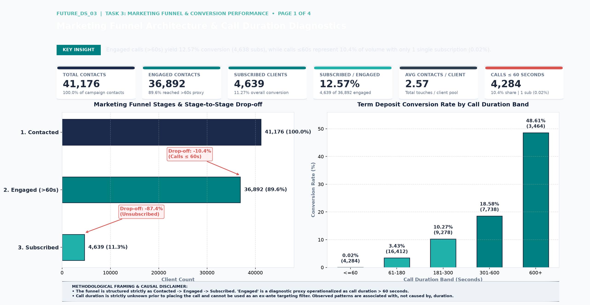
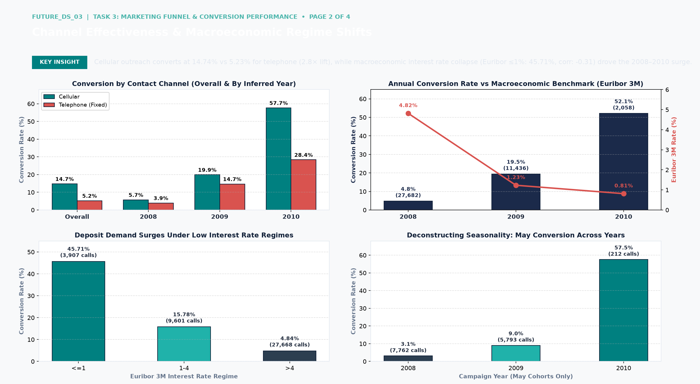
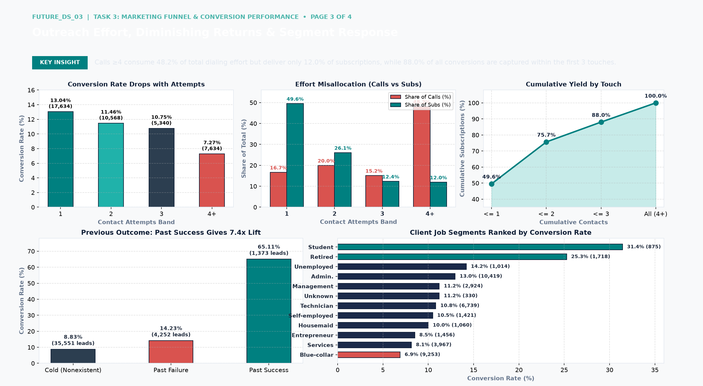
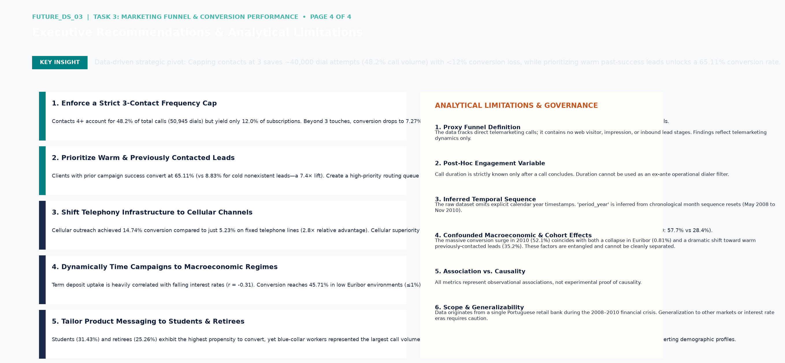

# FUTURE_DS_03: Marketing Funnel & Conversion Performance Analysis
**Future Interns Data Science & Analytics — Task 3**

---

## 1. Executive Summary & Business Problem

Direct telemarketing campaigns for long-term retail bank deposits face significant trade-offs between outbound sales effort and customer conversion yield. When outbound call volume escalates without strategic targeting, operational costs rise, agent fatigue sets in, and customer contact lists suffer diminishing returns.

This project analyzes **41,176 telemarketing contacts** from a Portuguese banking institution between **May 2008 and November 2010** to evaluate:
1. **Funnel Progression & Engagement:** Where clients drop out of the interaction sequence, using an operational call engagement threshold (>60 seconds).
2. **Channel Performance:** The comparative conversion efficiency of cellular versus fixed telephone channels across distinct campaign years.
3. **Effort Efficiency & Diminishing Returns:** The marginal conversion yield of repeated contact attempts and the point of campaign exhaustion.
4. **Macroeconomic Confounding:** The relationship between interest rate climate (3-month Euribor) and retail term deposit demand.
5. **Client Segmentation:** High-propensity demographic and behavioral segments (past campaign success, students, retirees) versus low-yielding volume pools (blue-collar workers).

---

## 2. Dashboard

The complete 4-page executive dashboard is available as a PDF: [`dashboard/FUTURE_DS_03_dashboard.pdf`](dashboard/FUTURE_DS_03_dashboard.pdf).

### Page 1: Marketing Funnel Architecture & Call Duration Diagnostics


### Page 2: Channel Effectiveness & Macroeconomic Shifts


### Page 3: Campaign Effort, Yield & Demographic Response


### Page 4: Strategic Recommendations & Methodological Constraints


---

## 3. Dataset Citation & License

- **Dataset:** Bank Marketing Dataset (`bank-additional-full.csv`)
- **Source:** UC Irvine Machine Learning Repository
- **Citation:**
  > Moro, S., Cortez, P., & Rita, P. (2014). *A data-driven approach to predict the success of bank telemarketing.* Decision Support Systems, 62, 22–31. https://doi.org/10.1016/j.dss.2014.03.001
- **License:** Creative Commons Attribution 4.0 International ([CC BY 4.0](https://creativecommons.org/licenses/by/4.0/))
- **Integrity Notice:** The raw source file `data/bank-additional-full.csv` remains strictly unmodified and preserved in its original form.

---

## 4. Tools & AI Assistance Disclosure

- **Runtime & Libraries:** Python 3 (standard dependencies: `pandas`, `numpy`, `matplotlib`). No other external dependencies.
- **AI Disclosure:** An AI assistant (Google Antigravity / Gemini) helped write and review the code and draft this documentation; all numerical results, metrics, and figures were empirically computed and programmatically verified against the underlying data.

---

## 5. Analytical Framing & Methodological Guardrails

- **Strict Funnel Architecture:** The dataset records outbound telemarketing calls; it contains **no website visitor, pageview, ad click, impression, or inbound lead stages**. The funnel is structured strictly as:
  $$\text{Contacted} \longrightarrow \text{Engaged} \longrightarrow \text{Subscribed}$$
- **Operational Proxy for Engagement:** "Engaged" is operationalized as a completed call lasting **longer than 60 seconds** (`duration > 60`). 
  > [!IMPORTANT]
  > Call duration is strictly unknown before dialing and is only recorded after the conversation concludes. Therefore, engagement serves as an ex-post diagnostic proxy for call quality rather than an ex-ante targeting filter.
- **Causal Disclaimer:** All statistical patterns reported herein are **associated with**, never **caused by**, the examined attributes.

---

## 6. Data Cleaning & Transformation Summary

Data cleaning is automated in [`scripts/01_clean_bank.py`](scripts/01_clean_bank.py) and fully audited in [`docs/cleaning_log.md`](docs/cleaning_log.md):

1. **Raw Dimensions & Ingestion:** Read `data/bank-additional-full.csv` (`sep=";"`) containing **41,188 rows** and **21 columns**.
2. **Missing Values ('unknown'):** Categorical unknowns were kept as explicit valid categories. In the raw dataset:
   - `job`: 330 unknown
   - `marital`: 80 unknown
   - `education`: 1,731 unknown
   - `default`: 8,597 unknown
   - `housing`: 990 unknown
   - `loan`: 990 unknown
3. **Temporal Reconstruction (`period_year`):** Derived chronologically on the file sequence *prior* to deduplication. Starting at baseline year 2008, each decrease in `month_num` increments the inferred calendar year (spanning May 2008 to November 2010).
4. **Deduplication:** Identified and dropped **12 exact duplicate rows** (`keep='first'`), resulting in **41,176 clean rows**.
5. **Column Standardization:** Transformed all dot-separated headers to snake_case (`emp.var.rate` $\to$ `emp_var_rate`, `cons.price.idx` $\to$ `cons_price_idx`, `euribor3m` $\to$ `euribor3m`, `nr.employed` $\to$ `nr_employed`).
6. **Engineered Analytical Features:**
   - `converted` (1/0 from `y == 'yes'`)
   - `engaged` (1 if `duration > 60` else 0)
   - `duration_band` (`<=60`, `61-180`, `181-300`, `301-600`, `600+`)
   - `contact_attempts_band` (`1`, `2`, `3`, `4+` from `campaign`)
   - `previously_contacted` (`Yes` if `pdays != 999` else `No`)
   - `euribor_band` (`<=1`, `1-4`, `>4` on `euribor3m`)

---

## 7. Funnel Key Performance Indicators (KPIs)

All metrics computed on the clean dataset of 41,176 contacts:

| Metric | Count / Value | Share / Rate | Context & Analytical Significance |
|:---|---:|---:|:---|
| **Total Contacts** | 41,176 | 100.00% | Full outreach base across all campaigns |
| **Engaged Contacts (>60s)** | 36,892 | 89.60% | Calls exceeding minimal 60-second operational duration threshold |
| **Subscribed Clients** | 4,639 | 11.27% | Successful term deposit subscriptions overall |
| **Conversion of Engaged** | 4,639 / 36,892 | 12.57% | Subscription rate among contacts lasting >60s |
| **Calls $\le$ 60 Seconds** | 4,284 | 10.40% | Non-engaged drop-offs; yielded **only 1 subscription** (0.02% conversion) |
| **Average Touches / Client** | 2.57 | — | Mean calls placed per individual client (`campaign.mean()`) |
| **Total Call Contacts Placed** | 105,735 | — | Aggregate outbound dialing volume (`campaign.sum()`) |

---

## 8. Key Findings & Empirical Insights

### A. Call Duration & Stage Drop-off
- **Short-call futility:** Calls lasting $\le 60$ seconds represent **10.40%** of all calls (4,284 attempts) but resulted in virtually zero conversions (exactly **1** subscription, 0.02% conversion rate).
- **Duration gradient:** Conversion rises sharply across duration bands:
  - $\le 60$ s: **0.02%** (1 sub / 4,284 calls)
  - $61–180$ s: **3.43%** (563 subs / 16,412 calls)
  - $181–300$ s: **10.27%** (953 subs / 9,278 calls)
  - $301–600$ s: **18.58%** (1,438 subs / 7,738 calls)
  - $600+$ s: **48.61%** (1,684 subs / 3,464 calls)

### B. Channel Performance: Cellular vs. Telephone
- Overall, **cellular outreach achieved 14.74% conversion** (3,852 subs / 26,135 calls) compared to **5.23% for fixed telephone** (787 subs / 15,041 calls) — a **2.8$\times$ relative performance advantage**.
- The cellular advantage remained robust across all three campaign years:
  - **2008:** Cellular 5.73% vs Telephone 3.93% (1.46$\times$ ratio)
  - **2009:** Cellular 19.90% vs Telephone 14.67% (1.36$\times$ ratio)
  - **2010:** Cellular 57.66% vs Telephone 28.35% (2.03$\times$ ratio)

### C. Campaign Effort & Severe Diminishing Returns
- **88.0% of all conversions** occur within the first 3 touches:
  - Contact 1: 49.6% cumulative subscriptions (2,299 subs, 13.04% conversion)
  - Contact 2: 75.7% cumulative subscriptions (1,211 subs, 11.46% conversion)
  - Contact 3: 88.0% cumulative subscriptions (574 subs, 10.75% conversion)
- **Extreme waste in 4+ attempts:** Clients dialed 4 or more times received **50,945 calls (48.18% of total dialing effort)**, yet generated only **555 subscriptions (11.96% of conversions)**, converting at just **7.27%**.

### D. Macroeconomic Shifts & The May Seasonality Deconstruction
- Conversion rate is moderately negatively correlated with the 3-month Euribor benchmark ($r = -0.31$):
  - Computed band mean for $\le 1$: **0.79** (3,907 calls, **45.71%** conversion)
  - Computed band mean for $1–4$: **1.33** (9,601 calls, **15.78%** conversion)
  - Computed band mean for $>4$: **4.82** (27,668 calls, **4.84%** conversion)

#### Euribor Band Rows by Period Year
| Euribor Band | 2008 | 2009 | 2010 | Total Rows | Mean Euribor3m | Conversion Rate (%) |
|:---|---:|---:|---:|---:|---:|---:|
| **$\le 1$** | 0 | 2,048 | 1,859 | 3,907 | 0.79 | 45.71% |
| **$1–4$** | 14 | 9,388 | 199 | 9,601 | 1.33 | 15.78% |
| **$>4$** | 27,668 | 0 | 0 | 27,668 | 4.82 | 4.84% |

- **Yearly mean euribor3m:** 2008 = **4.82**, 2009 = **1.23**, 2010 = **0.81**.
- **Seasonality Myth:** In aggregate, May shows a pooled conversion rate of **6.44%** (886 subs / 13,767 calls). However, examining May by year reveals that seasonality is an artifact of the macroeconomic shift:
  - May 2008: 7,762 calls $\to$ **3.09%** conversion
  - May 2009: 5,793 calls $\to$ **9.05%** conversion
  - May 2010: 212 calls $\to$ **57.55%** conversion

### E. Prior Contact & High-Converting Demographics
- **Warm Leads Lift:** Clients with prior campaign success (`poutcome == 'success'`) converted at **65.11%** (vs 8.83% for cold non-existent leads, a 7.4$\times$ lift). Previously contacted clients (`previously_contacted == 'Yes'`) converted at **63.83%**.
- **High-affinity Demographics:** Students (**31.43%**, 875 contacts) and retirees (**25.26%**, 1,718 contacts) converted at rates **4.6$\times$** and **3.7$\times$** higher than blue-collar workers (**6.90%**, 9,253 contacts).

---

## 9. Strategic Recommendations (Ranked)

1. **Enforce an Automated 3-Contact Frequency Cap:**
   - *Finding:* Capping outreach at 3 attempts per client removes only the calls beyond the third attempt: $\sum \max(\text{campaign} - 3, 0) = 28,043$ calls (26.5% of all 105,735 calls). Up to 555 subscriptions (12.0%) came from clients with 4+ attempts, so that is the maximum volume at risk.
   - *Action:* Hard-cap outbound dialer campaigns at 3 attempts per client. Beyond 3 touches, conversion drops to 7.27%, making repeated retries an inefficient use of dialer resources.
2. **Prioritize Warm Leads & Prior Campaign Successes in Routing Queues:**
   - *Finding:* Prior campaign success converts at **65.11%** (vs 8.83% for cold leads).
   - *Action:* Create a dedicated VIP queue for clients previously contacted in past campaigns with positive outcomes (`pdays != 999` and `poutcome == 'success'`) and route them immediately to senior sales specialists.
3. **Transition Outbound Dialing Infrastructure to Cellular Channels:**
   - *Finding:* The 2.8$\times$ figure (14.74% cellular vs 5.23% fixed telephone) is the raw overall ratio and is inflated because telephone calls were concentrated in 2008 (a low-conversion year). The within-year ratios are 1.46$\times$ in 2008 (5.73% vs 3.93%), 1.36$\times$ in 2009 (19.90% vs 14.67%), and 2.03$\times$ in 2010 (57.66% vs 28.35%).
   - *Action:* Prefer mobile numbers where available and A/B test before changing list policy.
4. **Evaluate Macroeconomic Interest Rate Regimes as a Hypothesis to Test:**
   - *Finding:* Conversion rates are higher during low-interest periods ($\le 1\%$ Euribor converts at 45.71% vs 4.84% when $>4\%$). However, because interest rate drops were entangled with a progressive operational shift toward warm re-contact lists (from 0.1% warm in 2008 to 35.2% warm in 2010), these macroeconomic and cohort effects cannot be separated observationally.
   - *Action:* Treat macroeconomic alignment as a hypothesis to test: design controlled tests during shifting benchmark interest rate regimes to isolate whether deposit demand changes independently of list warmth.
5. **Test Tailored Offers for Students and Retirees:**
   - *Finding:* Students (31.43%) and retirees (25.26%) exhibit the highest propensity to convert, yet blue-collar workers represent the single largest volume pool (9,253 contacts) with the lowest yield (6.90%).
   - *Action:* Test tailored offers for students and retirees (such as starter savings accounts for students and capital preservation deposits for retirees) rather than relying on indiscriminate high-volume outreach.

---

## 10. Analytical Limitations

1. **Proxy Funnel Architecture:** Data tracks direct outbound phone contacts, without digital impressions, web visits, or inbound MQL stages.
2. **Post-Hoc Duration Metric:** Call duration is only known after call termination. It cannot be used as an ex-ante operational dialing rule.
3. **Inferred Year Timestamps:** `period_year` is reconstructed from monthly sequence drops (May 2008 to Nov 2010), not an explicit raw timestamp.
4. **Macroeconomic & Warm-List Confounding:** The dramatic 2010 conversion surge (52.14%) coincided with both historically low Euribor rates (0.81%) and an intentional operational shift toward warm re-contact lists (35.2% previously contacted in 2010 vs 0.1% in 2008). These two drivers are entangled and cannot be isolated without randomized controlled trial data.
5. **Observational Associations:** All relationships represent statistical associations, not causal proofs.
6. **External Validity:** The data represents a single Portuguese retail bank during the 2008–2010 global financial crisis; dynamics may differ across modern digital banking environments.

---

## 11. How to Reproduce

### Prerequisites
Install the standard dependencies:
```bash
pip3 install -r requirements.txt
```

### Execution Pipeline
Run the three plain-Python scripts in sequence:

```bash
# 1. Clean raw dataset, engineer features, and write cleaning log
python3 scripts/01_clean_bank.py

# 2. Build multi-page PDF dashboard and standalone 16:9 page images
python3 scripts/02_build_dashboard.py

# 3. Run automated verification test suite
python3 scripts/03_check_results.py
```

---

## 12. Repository Structure

```
FUTURE_DS_03/
├── data/
│   ├── bank-additional-full.csv     # Raw dataset (unmodified, 41,188 rows)
│   ├── bank-additional-names.txt    # Raw dataset documentation
│   └── bank_clean.csv               # Cleaned & engineered dataset (41,176 rows)
├── docs/
│   └── cleaning_log.md              # Detailed data cleaning & transformation log
├── dashboard/
│   └── FUTURE_DS_03_dashboard.pdf   # 4-page executive PDF dashboard (16:9)
├── images/
│   ├── page_1.png                   # Page 1: Funnel & Call Duration Diagnostics
│   ├── page_2.png                   # Page 2: Channel Effectiveness & Macro Trends
│   ├── page_3.png                   # Page 3: Effort Yield & Segment Propensity
│   └── page_4.png                   # Page 4: Strategic Recommendations & Limitations
├── scripts/
│   ├── 01_clean_bank.py             # Data cleaning and feature engineering
│   ├── 02_build_dashboard.py        # Matplotlib visualization and PDF generation
│   └── 03_check_results.py          # Automated verification test suite
├── requirements.txt                 # Project dependencies (pandas, numpy, matplotlib)
└── README.md                        # Comprehensive project documentation
```
